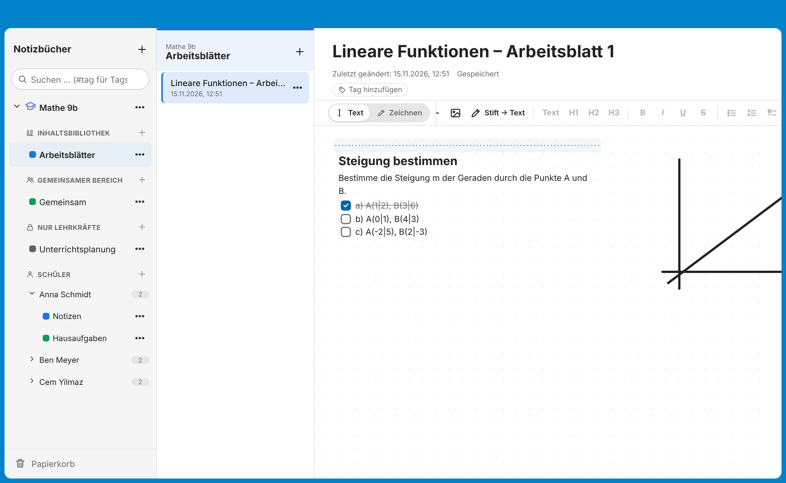
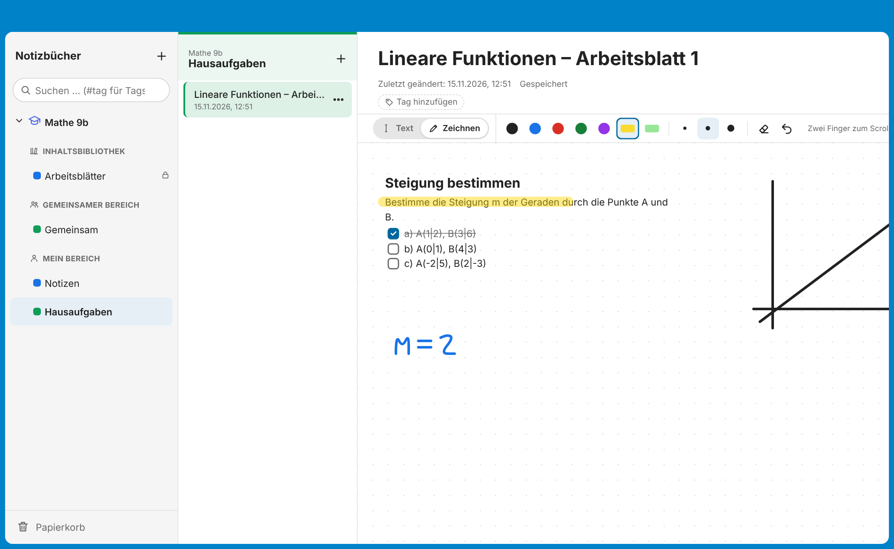
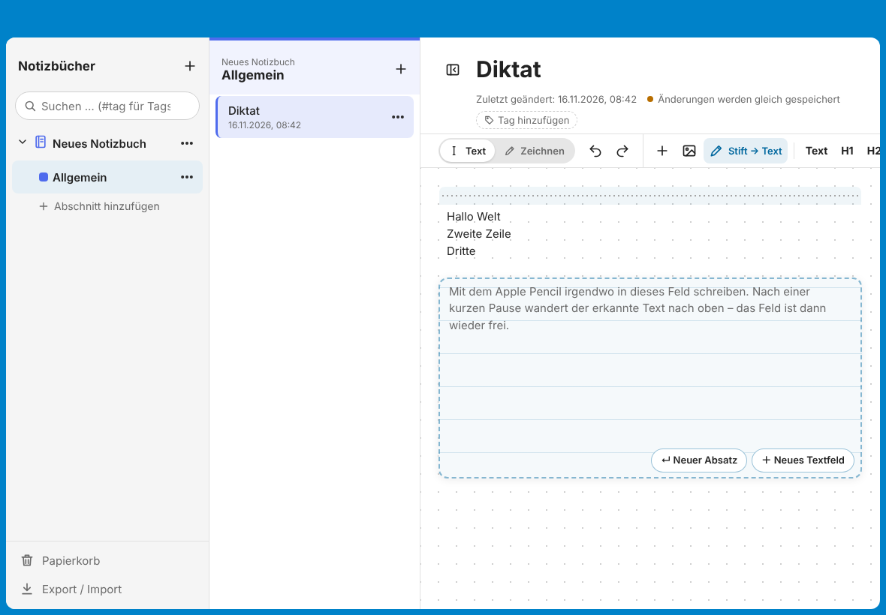
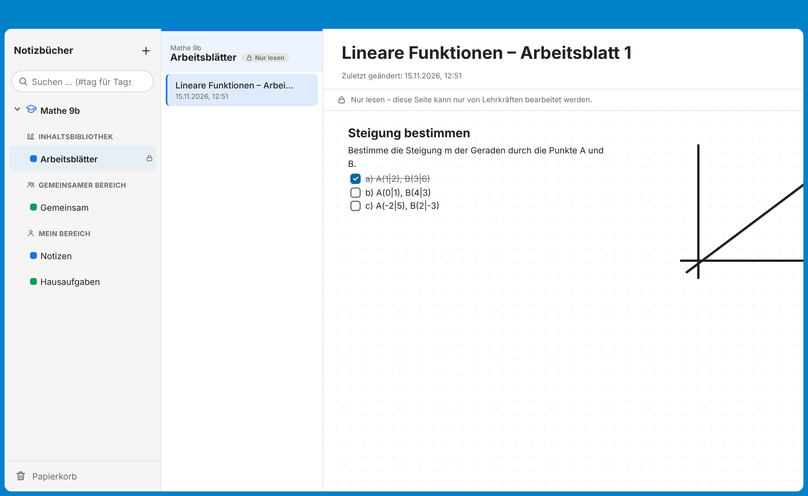
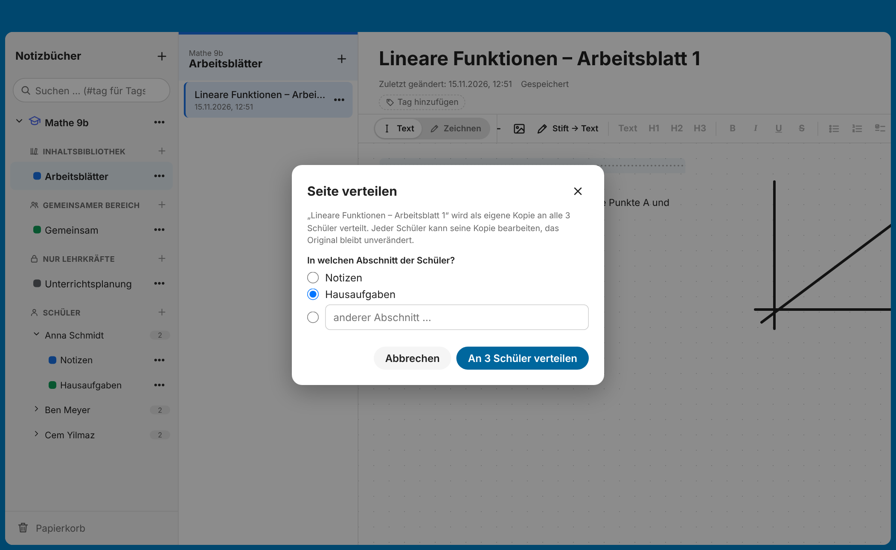

# Kladory

**Digitale Notizbücher für Nextcloud – mit Kursnotizbüchern für die Schule, freier Leinwand und Apple-Pencil-Unterstützung.**

adory ist eine Notizen-App für Nextcloud, die ein digitales Notizbuch-Erlebnis bietet. Nutzer können Notizbücher mit farbigen Abschnitten und frei gestaltbaren Seiten erstellen, auf denen sich Texte, Zeichnungen und handschriftliche Notizen kombinieren lassen. Für den schulischen Einsatz gibt es spezielle Kursnotizbücher mit einer Inhaltsbibliothek, einem gemeinsamen Arbeitsbereich, einem Lehrkräftebereich sowie persönlichen Bereichen für jede Schülerin und jeden Schüler.

Alle Daten bleiben auf dem eigenen Nextcloud-Server. Keine Cloud eines Drittanbieters, keine Telemetrie.

*English: Kladory is a notebook app for Nextcloud (notebooks → sections → pages) with a free-form canvas, pen input for iPad/Apple Pencil and OneNote-style class notebooks for schools. The user interface is currently German only.*



## Funktionen

- **Notizbücher → Abschnitte → Seiten**, farbig sortiert, mit Volltextsuche und Tags
- **Freie Leinwand:** Textfelder und Bilder frei platzieren, verschieben, in der Größe ändern
- **Zeichnen mit Stift oder Finger:** Farben, Textmarker, Strichstärken, Radierer, Rückgängig/Wiederholen
- **Auswählen:** Gezeichnetes umkreisen, verschieben, vergrößern, verkleinern, duplizieren, löschen
- **Stift → Text:** Handschrift mit dem Apple Pencil in Text umwandeln (über iPadOS „Scribble“, ohne KI-Dienst)
- **Kursnotizbücher:** Inhaltsbibliothek (für Schüler nur lesbar), gemeinsamer Bereich, „Nur Lehrkräfte“, eigener Bereich pro Schüler; Mitglieder als Benutzer oder ganze Gruppen (auch aus LDAP); Seiten mit einem Klick an alle Schüler verteilen
- **Papierkorb** mit einstellbarer Aufbewahrungszeit
- **Export/Import** eigener Notizbücher (auch komplette Kursnotizbücher für Lehrkräfte)
- **Automatisches Speichern** mit Statusanzeige, Wiederholung bei Funklöchern und Konflikterkennung, wenn zwei Personen gleichzeitig dieselbe Seite bearbeiten
- **Für iPad, PC und Handy** ausgelegt, mit hellem und dunklem Design
- **Admin-Befehle** (`occ`) für Papierkorb, Export/Import und das Übertragen von Daten nach Umbenennung eines Kontos

| | |
|---|---|
|  |  |
| *Hausaufgabe mit dem Stift* | *Stift → Text mit dem Apple Pencil* |
|  |  |
| *Inhaltsbibliothek aus Schülersicht* | *Seite an alle Schüler verteilen* |

Weitere Bilder liegen im Ordner [`screenshots`](screenshots/).

## Voraussetzungen

- Nextcloud **35**
- PHP **8.2** oder neuer
- Empfohlen für viele gleichzeitige Nutzer: ein Memcache (z. B. Redis), siehe [Betrieb](docs/BETRIEB.md#leistung-und-lasttest-ab-070)

## Installation

1. Unter [Releases](../../releases) die neueste Datei `kladory-<version>.tar.gz` herunterladen.
2. Entpacken – es entsteht der Ordner `kladory`.
3. Den Ordner in das App-Verzeichnis der Nextcloud kopieren (`apps/` oder `custom_apps/`) und dem Webserver-Benutzer übergeben.
4. App aktivieren:

```bash
sudo -u www-data php occ app:enable kladory
```

Mit Docker (offizielles Image):

```bash
tar xzf kladory-<version>.tar.gz
docker cp kladory nextcloud:/var/www/html/custom_apps/
docker exec nextcloud chown -R www-data:www-data /var/www/html/custom_apps/kladory
docker exec -u www-data nextcloud php occ app:enable kladory
```

Beim linuxserver.io-Image liegt das App-Verzeichnis unter `/app/www/public/apps`, der Benutzer heißt `abc`.

**Update:** alten Ordner `kladory` durch den neuen ersetzen, Besitzer setzen, dann `php occ upgrade` ausführen und den Browser neu laden.

Ausführliche Hinweise zu Kursnotizbüchern, Datensicherung, Papierkorb, Export/Import und allen `occ`-Befehlen stehen in [docs/BETRIEB.md](docs/BETRIEB.md).

## Datenschutz

- Inhalte und Bilder liegen ausschließlich in der Datenbank und im App-Datenordner der eigenen Nextcloud.
- Die Handschrifterkennung („Stift → Text“) läuft auf dem iPad selbst (Apple Scribble), Kladory schickt keine Daten an externe Dienste.
- Wird ein Benutzerkonto gelöscht, löscht Kladory dessen Daten endgültig. Kursnotizbücher gehen an eine weitere Lehrkraft über, falls vorhanden.

## Status

Kladory wird an einer Schule im Alltag getestet und weiterentwickelt. Die Versionsnummer beginnt mit 0 – Funktionen und Datenformat können sich noch ändern. Vor jedem Update eine Datensicherung machen.

## Fehler melden und mitmachen

- Fehler und Wünsche bitte als [Issue](../../issues) melden – mit Nextcloud-Version, Gerät/Browser und möglichst einem Bildschirmfoto.
- Sicherheitslücken bitte **nicht** öffentlich melden, sondern wie in [SECURITY.md](SECURITY.md) beschrieben.
- Änderungen sind über Pull Requests willkommen.

## Lizenz

Kladory ist freie Software unter der [GNU Affero General Public License v3.0 oder neuer](LICENSE) (AGPL-3.0-or-later) – wie Nextcloud selbst.

„Nextcloud“ ist eine Marke der Nextcloud GmbH. Kladory ist ein unabhängiges Projekt. 
